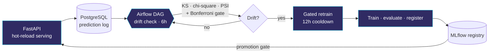
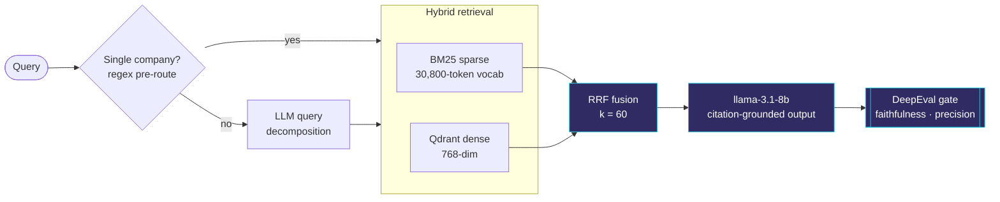
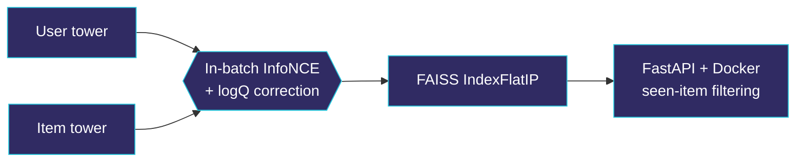

<div align="center">


<a href="https://github.com/kushagra651">
  
</a>

<br/><br/>

[](https://www.linkedin.com/in/kushagrabhargava651)
[](mailto:kushagrabhargava93@gmail.com)
[](https://huggingface.co/aapnakaamkar)
[](https://substack.com/@kushagrabhargava)
[](tel:+916350655535)

<br/>


</div>

---

## ✦ ABOUT

I like the whole arc of an ML system: data, model, serving, monitoring, and the measurement that tells you whether any of it worked. Everything below is a personal build, and I document what failed as readily as what worked: a loss function that beat my architecture, an accuracy gate that sat below the majority baseline, a cold-start test that leaked and had to be rebuilt.

<table>
<tr>
<td width="50%" valign="top">

**🔧 What I do**
- Monitoring, drift detection and gated retraining
- Hybrid retrieval and RAG with measurable evals
- Two-tower recommenders and ranking
- Serving with FastAPI, Docker and CI/CD

</td>
<td width="50%" valign="top">

**📌 Quick facts**
- Final-year B.E. Information Science, DSCE Bengaluru
- Contributed to **Giskard AI** (PR #2440, Bias LLM Judge eval check) and **pgmpy** (PR on composable regressors for structure scoring)
- Kaggle **Top 16%** (350 / 2,247, Spaceship Titanic)
- Worked on a churn model (ROC-AUC 0.91 vs 0.73 baseline) during a Jan to Mar 2026 ML internship at Fitin

</td>
</tr>
</table>

---

## ✦ TECH STACK

<div align="center">

**Languages**


**ML and Data**


**LLMs and Retrieval**


**MLOps and Serving**


**Databases and Cloud**


**Tools**


</div>

---

## ✦ CORE STRENGTHS

| Domain | Level of work | Details |
|:--|:--|:--|
| 🧮 **Problem solving** | Daily practice | Data structures and algorithms in Python and C++; reasoning about complexity, trade-offs and edge cases before writing code |
| 🗄️ **SQL and databases** | Hands-on | PostgreSQL, MySQL, MongoDB; schema design, prediction logging, analytical queries over model outputs |
| ⚙️ **MLOps** | Project-proven | Drift detection, gated retraining, registry and promotion gates, CI/CD, load testing, Prometheus and Grafana metrics |
| 🔍 **Retrieval and RAG** | Project-proven | BM25 + dense hybrid search, RRF fusion, citation-grounded generation, DeepEval faithfulness and context precision |
| 🎯 **Recommenders** | Project-proven | Two-tower retrieval, InfoNCE, logQ correction, full-catalog evaluation, FAISS serving |
| 🧪 **LLM adaptation** | Project-proven | LoRA / QLoRA fine-tuning, 4-bit quantization on a low-VRAM budget |

---

## ✦ FEATURED PROJECTS

### 🛡️ SentinelML: ML monitoring and auto-retraining

`Airflow` `MLflow` `FastAPI` `PostgreSQL` `Prometheus` `Docker Compose` · [Repo](https://github.com/kushagra651/SentinelML)



| Result | Number |
|:--|:--|
| False drift alarms (offline), before → after | **44% → 1.5%** |
| Harmless drift ignored / moderate drift caught | 0% alarms at intensity 0.1 and 0.2 / 100% at 0.3 |
| Retrain value under severe synthetic drift | accuracy 86.7% → 80.0%, retraining recovered about 80% of the loss (upper bound) |
| Load test | 50 req/s ceiling, p95 298 ms, 0% errors at 10 concurrent users |

What I learned: my own 0.75 accuracy gate sat below the 75.4% majority baseline, so I raised it to 0.76 and validated the 0.001 ROC-AUC promotion delta against seed noise.

---

### 🔍 FintelRAG: financial document intelligence

`Qdrant` `BM25` `LangGraph` `Groq` `DeepEval` · [Repo](https://github.com/kushagra651/FintelRAG)



| Result | Number |
|:--|:--|
| DeepEval faithfulness | **0.48 → 0.89** (+84%) |
| Context precision | **0.51 → 1.00** (+97%), across 20 QA pairs |
| Corpus | 4,737 SEC 10-K chunks, section-aware with contextual headers |
| Cold-start latency | **200 s → under 1 s** (persisted BM25 corpus) |
| End-to-end query latency | 10 to 15 s |

---

### 🎯 RecTower: two-tower retrieval recommender

`PyTorch` `FAISS` `FastAPI` `Docker` · [Repo](https://github.com/kushagra651/RecTower)



| Result | Number |
|:--|:--|
| Full-catalog NDCG@10 (MovieLens-1M, 575K interactions) | **0.016 → 0.0347** (mean of 3 seeds), about 10% above tuned BPR-MF (0.0315) and ItemKNN (0.0308) |
| Honest finding | MF trained with the same loss scored 0.0406, so the loss mattered more than the architecture |
| Evaluation fixes | Replaced inflated sampled 1+99 metrics, rebuilt a leaky cold-start test on 1,000 held-out users |
| Serving | retrieval p99 3.3 ms, end-to-end HTTP p99 24.7 ms (localhost, CPU), 24 pytest tests |

---

### 🧱 Also built

| Project | What it is |
|:--|:--|
| **LexRA** | QLoRA fine-tune of TinyLlama 1.1B on Indian legal text, [on HuggingFace](https://huggingface.co/aapnakaamkar) |
| **MediFlow** | Hospital demand forecasting with SHAP explainability and FastAPI |
| **VC AI Agents** | Multi-agent due-diligence loops with Pydantic-validated outputs |

[→ Browse all repositories](https://github.com/kushagra651?tab=repositories)

---

## ✦ HOW I WORK

```text
1. Baseline first      a number to beat before any model gets complicated
2. Evaluate honestly   full-catalog ranking, seeds, confidence intervals, no leaky splits
3. Gate everything     drift, promotion and faithfulness gates, so regressions fail loudly
4. Report negatives    if a simpler method wins, the README says so
```

---

## ✦ CURRENT FOCUS

```bash
kushagra@dev:~$ status --current

🌱 Learning   : distributed model serving, batching and latency budgets
🔨 Building   : evaluation harnesses for RAG and agent pipelines
🧭 Exploring  : LLM-as-judge reliability, experiment tracking, reproducibility
☁️  Practising : SageMaker and Vertex AI workflows
🧮 Sharpening : DSA and SQL, weekly
📬 Open to    : ML / AI internships (PPO path), remote or Bengaluru
```

I write up what I learn on [Substack](https://substack.com/@kushagrabhargava).

---

## ✦ CONTRIBUTION SNAKE

<div align="center">
  <picture>
    <source media="(prefers-color-scheme: dark)" srcset="https://raw.githubusercontent.com/kushagra651/kushagra651/output/github-snake-dark.svg" />
    <source media="(prefers-color-scheme: light)" srcset="https://raw.githubusercontent.com/kushagra651/kushagra651/output/github-snake.svg" />
    
  </picture>
</div>

---

## ✦ GITHUB SNAPSHOT

<div align="center">
  
  
  <br/>
  
</div>

---

## ✦ LET'S TALK

I'm looking for an ML / AI engineering internship with a path to full-time. If you're building retrieval, evals or ML infrastructure and want someone who measures before claiming, I'd like to hear from you.

| | |
|:--|:--|
| 📧 **Email** | [kushagrabhargava93@gmail.com](mailto:kushagrabhargava93@gmail.com) |
| 💼 **LinkedIn** | [linkedin.com/in/kushagrabhargava651](https://www.linkedin.com/in/kushagrabhargava651) |
| 📞 **Phone** | [+91 6350655535](tel:+916350655535) |
| 🤗 **HuggingFace** | [aapnakaamkar](https://huggingface.co/aapnakaamkar) |
| ✍️ **Substack** | [@kushagrabhargava](https://substack.com/@kushagrabhargava) |


